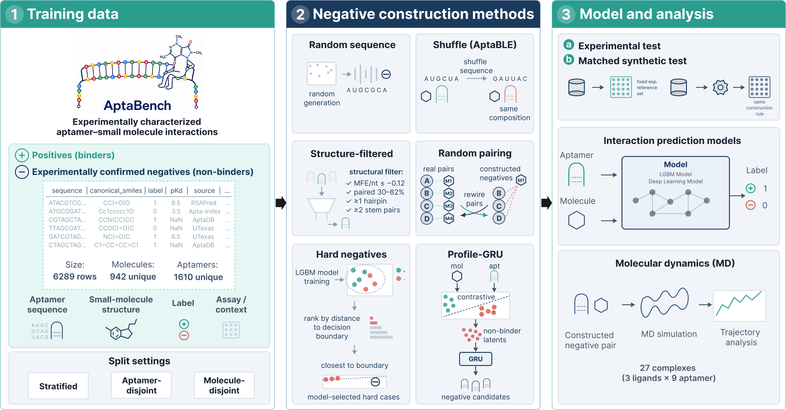

<p align="center">
  
</p>

# Evaluating Negative Construction for Aptamer–Small Molecule Interaction Learning

[](https://neurips.cc/virtual/2026/loc/paris/162339)
[](https://openreview.net/forum?id=kUDLY2pyES)
[](https://github.com/GenerativeMolMachines/AptaBench)
[](LICENSE)

## About

How much does the way we construct **synthetic non-binders** change an aptamer–small molecule interaction model? This repository compares six constructors on AptaBench. Experimental positives, held-out experimental test pairs, AptaBench folds, and the main LightGBM pipeline stay fixed; only the training negatives change.

| Data | Evaluation | Reference |
|---|---|---|
| AptaBench aptamer–ligand pairs | Five folds each: stratified, aptamer-disjoint, molecule-disjoint | Experimentally characterized binders and non-binders |
| Six synthetic constructors | Experimental-reference evaluation (ERE) on fixed held-out pairs | Experimental training negatives |

**Main finding:** matched synthetic tests can substantially overstate performance against experimental non-binders. In the revised LightGBM run, Random pairing has the highest experimental-test ROC-AUC among synthetic methods on all three splits. See the [fold metrics](analyses/results/ere_metrics.csv) and [leakage audit](analyses/results/leakage_audit.csv).

## How the benchmark works

1. Use one released AptaBench train/test fold.
2. Keep its positives and experimental test pairs fixed.
3. Construct training negatives using the information allowed for each training fold.
4. Fit the same classifier and evaluate on the same experimental test pairs.

| Constructor in the paper | ID in code and CSV | Core idea | Experimental-negative information used by the constructor |
|---|---|---|---|
| Random sequence | `random_sequence` | Generate decoy sequences | Ligand counts for matching |
| Composition shuffle | `composition_shuffle` | Shuffle aptamers while preserving composition | Ligand counts for matching |
| Structure-filtered | `structure_filtered` | Filter candidate sequences by structure | Ligand counts for matching |
| Random pairing | `random_pairing` | Rewire observed aptamers and ligands | Ligand counts; known pairs excluded |
| Hard negatives | `hard_negative` | Select difficult candidates with a scorer trained within each fold | Experimental negatives train the scorer |
| Profile-GRU | `learned_generated` | Rank precomputed sequence candidates for each fold | Experimental-negative profiles and contrastive supervision |

The `split_type` column in current result CSVs, including the [source-held-out metrics for Table 6](analyses/results/fold_source_metrics.csv), uses `random` for **Stratified**, `aptamer` for **Aptamer-disjoint**, and `molecule` for **Molecule-disjoint**. Use the same IDs in `by_fold/` paths and command-line split arguments.

The **experimental** row is a reference training condition, not a synthetic constructor. Except for that reference and explicit blend controls, the downstream classifier trains on emitted synthetic negatives.

## Install and run

```bash
git clone https://github.com/OpiumProger/Neurips_AIDAR.git
cd Neurips_AIDAR
python -m venv .venv
# Activate .venv for your shell, then:
pip install -r requirements.txt
python scripts/02_run_benchmark.py --lgbm-hard-score --out results/ere
python scripts/audit_ere_pairs.py results/ere/constructed --out results/ere/leakage_audit.csv
```

The main ERE run uses the released embeddings and generation input. Some optional generation and structure-filtering experiments need pretrained models, a GPU, or ViennaRNA; see [contrastive/README.md](contrastive/README.md).

## Reproduce the analyses

| Analysis | Entry point | Output |
|---|---|---|
| Main ERE on AptaBench folds | `scripts/02_run_benchmark.py --lgbm-hard-score --out results/ere` | `results/ere/` |
| Cross-negative comparison | `scripts/03_cross_negative_eval.py --cross-csv results/ere/cross_negative_metrics.csv --out results/ere/cross_negative_heatmap.csv` | `results/ere/cross_negative_heatmap.csv` |
| Repeated 10% experimental subsets | `scripts/04_run_amplification.py --n-repeats 10 --out results/amplification` | `results/amplification/` |
| Source-held-out sensitivity | `scripts/run_provenance_aptabench_folds.py` | `results/provenance_aptabench_folds/` |
| Table 3 Blend and Fraction-retrain | [Complete run commands](analyses/README.md#main-ere-protocol-revision) | `results/table3/table3_fold_metrics.csv` and `table3_summary.csv` |

Summary CSVs and interpretation are in [analyses/](analyses/). The commands write the outputs listed above when run from the repository root. Released analysis CSVs are available under `analyses/results/`.

Run `python scripts/07_make_figures.py` to regenerate the ERE plots from the published CSVs. To plot a new run, pass its output directory with `--ere-inputs`. The script also generates the archived volume and mix plots from their historical CSVs.

The three-panel paper figure is written to `results/figures/fig_main_comparison.pdf`. It combines the revised ERE scores, matched-test differences, and the repeated molecule-disjoint 10% control.

## Repository map

| Path | Contents |
|---|---|
| [data/aptabench/](data/aptabench/) | AptaBench table, split indices, embeddings, and generation input |
| [Revised fold pools](data/constructed_negatives/ere/by_fold/) | Negative sets used for the current ERE results |
| [Archived fold pools](data/constructed_negatives/ere_aptabench_scaled_v1/) | Earlier experiment inputs retained for historical comparison |
| [src/](src/) | Constructors, data loading, ERE, and analysis code |
| [contrastive/](contrastive/) | Contrastive model and GRU generation code |
| [scripts/](scripts/) | Reproduction commands |
| [analyses/](analyses/) | Repeated-subset and source sensitivity analyses |

## Interpretation

- AptaBench aptamer- and molecule-disjoint folds can share assays and database sources across train and test. The source sensitivity analysis holds out a database source within each AptaBench fold.
- Across ten redraws per molecule-disjoint fold, the 10%-only control gives ROC-AUC **0.826 ± 0.070**. Oversampling gives **0.824 ± 0.072**, adding Profile-GRU **0.802 ± 0.065**, and adding Random pairing **0.678 ± 0.095**. Synthetic augmentation uses the revised ERE pools. Redraws share test folds. The 10% limit applies to measured negatives supplied directly to LightGBM. [Summary and paired differences](analyses/).
- The main comparison holds the LightGBM classifier fixed. The [architecture comparison](analyses/results/architecture_summary.csv) evaluates LightGBM, MLP, two-tower MLP, and a CNN dual encoder on the same revised pools for stratified and molecule-disjoint splits.

## License and data

Code in this release is under [MIT](LICENSE). The [AptaBench dataset](https://huggingface.co/datasets/GenerativeMolMachines/AptaBench_dataset) by Mariia Eremeyeva and Nikita Serov is released under CC BY 4.0. The release contains 1,610 published aptamer sequences. Normalizing U to T yields 1,605. The released ligand embedding join covers 6,224 of 6,289 rows. See the [AptaBench repository](https://github.com/GenerativeMolMachines/AptaBench) for the citation.
